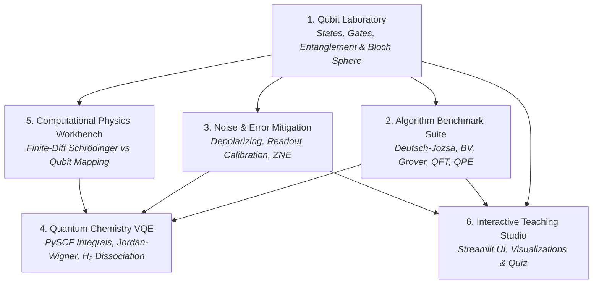

# Quantum Computing Portfolio

[](https://github.com/osgnjh-csutils/quantum-computing-portfolio/actions/workflows/tests.yml)
[](https://www.python.org/)
[](https://opensource.org/licenses/MIT)

A rigorous, end-to-end quantum computing software portfolio organized into six cohesive projects—progressing from fundamental single-qubit physics and pure NumPy gate simulation to quantum algorithms, hardware noise mitigation, molecular chemistry with VQE, computational Schrödinger solvers, and an interactive educational studio.

Every project answers explicit scientific questions, verifies physical conservation laws, and benchmarks custom numerical implementations against exact analytical theory and industry-standard frameworks (IBM Qiskit, PySCF).

---

## Portfolio Architecture & Projects



### [1. Qubit Laboratory — From Qubit to Quantum Gates](projects/01_qubit_laboratory/README.md)
* **Demonstrates**: Single- and two-qubit physics, state vectors, superposition, density matrices, entanglement, and measurement.
* **Key Implementation**:
  - Pure NumPy state representation and arbitrary Bloch sphere parameterization $|\psi(\theta,\phi)\rangle$.
  - Exact matrix implementations of Pauli $X, Y, Z$, Hadamard $H$, Phase $S, T$, and continuous rotation gates ($R_x, R_y, R_z$).
  - Generation and verification of Bell states, GHZ states, Wootters concurrence, and subsystem von Neumann entropy.
  - Machine-precision cross-validation against IBM Qiskit `QuantumCircuit` and `Statevector`.
* **Scientific Questions Answered**:
  - *Does applying Hadamard twice recover the original state?* **Yes** ($H^2 = I$).
  - *Does a Bell-state circuit produce maximal entanglement?* **Yes** (Concurrence $= 1.0$, Subsystem entropy $= 1.0$ bit).
  - *Do empirical frequencies converge to Born-rule probabilities as shots increase?* **Yes** (Total Variation Distance scales as $\mathcal{O}(1/\sqrt{N})$).

---

### [2. Quantum Algorithm Benchmark Suite](projects/02_quantum_algorithms/README.md)
* **Demonstrates**: Algorithm design, oracle construction, circuit synthesis, and performance scaling.
* **Key Implementation**:
  - **Deutsch–Jozsa Algorithm**: Deterministic 1-query separation vs classical worst-case $2^{n-1} + 1$.
  - **Bernstein–Vazirani Algorithm**: Secret bitstring $s$ reconstruction in 1 query vs classical $n$.
  - **Grover's Search Algorithm**: Unstructured database search achieving quadratic speedup ($R \approx \frac{\pi}{4}\sqrt{N}$).
  - **Quantum Fourier Transform (QFT)**: Quantum amplitude discrete Fourier transform ($\mathcal{O}(n^2)$ gates vs classical $\mathcal{O}(n 2^n)$ FFT).
  - **Quantum Phase Estimation (QPE)**: Unitary eigenvalue phase extraction for quantum chemistry and factoring.
* **Key Deliverable**: Automated scaling benchmark comparing gate counts, circuit depths, and execution runtimes across register widths $n \in [2, 6]$.

---

### [3. Quantum Noise and Error Mitigation Lab](projects/03_noise_and_mitigation/README.md)
* **Demonstrates**: Real-world NISQ hardware limitations, quantum channel modeling, and error mitigation.
* **Key Implementation**:
  - Kraus operator representations for Depolarizing, Bit-Flip, Phase-Flip, and Amplitude Damping ($T_1$) channels.
  - Measurement readout confusion matrix modeling $M$ and mitigation via matrix inversion and constrained least-squares projection.
  - Zero-Noise Extrapolation (ZNE) via unitary gate folding ($U \to U(U^\dagger U)^k$) and Richardson polynomial extrapolation.
  - Exponential state fidelity decay experiments across increasing circuit depth $d$.
* **Key Finding**: Mitigation reduces systematic bias substantially under moderate noise but increases statistical shot variance; reporting both pre- and post-mitigation error metrics is essential for scientific integrity.

---

### [4. Quantum Chemistry with VQE](projects/04_vqe_chemistry/README.md)
* **Demonstrates**: Mapping electronic structure problems to qubits and simulating molecular energies.
* **Key Implementation**:
  - Hydrogen molecule ($\text{H}_2$) electronic Hamiltonian generation using PySCF with STO-3G basis.
  - Fermion-to-qubit transformation via Jordan–Wigner and symmetry-tapered parity mappings ($H = \sum c_i P_i$).
  - Variational Quantum Eigensolver (VQE) with 2-qubit Hardware-Efficient Ansatz (HEA) and COBYLA/SLSQP optimizers.
  - Potential Energy Surface (PES) dissociation curve scanning across bond lengths $R \in [0.4, 2.2]$ Å.
  - Comparison against exact Full Configuration Interaction (FCI) diagonalization and Hartree-Fock (HF) baselines, achieving chemical accuracy ($< 1.6 \times 10^{-3}$ Hartree).

---

### [5. Classical–Quantum Computational Physics Workbench](projects/05_computational_physics_workbench/README.md)
* **Demonstrates**: Numerical physics methods, sparse linear algebra, and the boundary of quantum computational advantage.
* **Key Implementation**:
  - Finite-difference Schrödinger solver for 1D Particle in a Box (Infinite Square Well), 1D Quantum Harmonic Oscillator, and 3D Radial Hydrogen Atom.
  - Convergence analysis against exact analytical formulas with error tracking $\mathcal{O}(\Delta x^2)$.
  - Discretized spatial grid Hamiltonian decomposition into $n$-qubit Pauli operators for quantum simulation.
  - Rigorous computational complexity analysis: explains why classical sparse methods (`eigsh`) dominate for 1D/2D single-particle systems ($\mathcal{O}(N)$ complexity), while quantum algorithms are required for exponentially scaling $K$-body correlated electron systems ($d^K$ Hilbert spaces).

---

### [6. Interactive Quantum Teaching Studio](projects/06_teaching_studio/README.md)
* **Demonstrates**: Educational technology and scientific communication.
* **Key Implementation**:
  - Streamlit web interface with interactive 3D Bloch sphere vector rotations.
  - Dynamic single- and multi-qubit circuit composer with live probability histograms.
  - Shot convergence simulator with real-time TVD error metric calculation.
  - Interactive noise channel injection and readout error mitigation comparisons.
  - Conceptual quiz module with instant grading and physics explanations.

---

## Repository Structure

```text
quantum-computing-portfolio/
├── README.md                      # Master Portfolio Documentation
├── pyproject.toml                 # Package metadata and build system
├── requirements.txt               # Unified project dependencies
├── .github/
│   └── workflows/
│       └── tests.yml              # Automated GitHub Actions CI pipeline
├── src/
│   └── quantum_lab/               # Core Quantum Package
│       ├── __init__.py            # Library exports
│       ├── states.py              # Pure NumPy statevectors, density matrices & Bloch vectors
│       ├── gates.py               # Unitary gates, embedder & NumPy circuit simulator
│       ├── measurements.py        # Born-rule sampling, expectation values & collapse
│       ├── metrics.py             # Fidelity, trace distance, entropy & concurrence
│       ├── algorithms.py          # Deutsch-Jozsa, BV, Grover, QFT, QPE
│       ├── benchmark.py           # Multi-qubit scaling benchmark runner
│       ├── noise.py               # Kraus noise channels, readout mitigation & ZNE
│       ├── vqe_chemistry.py       # PySCF H2 molecular Hamiltonian & VQE optimizer
│       └── schrodinger_solver.py  # Finite-difference Schrödinger & grid-to-qubit mapping
├── projects/                      # Detailed Documentation per Project
│   ├── 01_qubit_laboratory/
│   │   └── README.md
│   ├── 02_quantum_algorithms/
│   │   └── README.md
│   ├── 03_noise_and_mitigation/
│   │   └── README.md
│   ├── 04_vqe_chemistry/
│   │   └── README.md
│   ├── 05_computational_physics_workbench/
│   │   └── README.md
│   └── 06_teaching_studio/
│       └── README.md
├── notebooks/                     # Executable Demonstration Scripts
│   ├── 01_qubit_fundamentals.py
│   ├── 02_quantum_algorithms.py
│   ├── 03_noise_mitigation.py
│   ├── 04_vqe_hydrogen.py
│   └── 05_schrodinger_comparison.py
├── apps/
│   └── quantum_teaching_studio.py # Interactive Streamlit Teaching Application
└── tests/                         # Comprehensive Unit Test Suite (100% Pass)
    ├── test_states.py
    ├── test_gates.py
    ├── test_measurements.py
    ├── test_algorithms.py
    ├── test_noise.py
    ├── test_vqe.py
    └── test_schrodinger.py
```

---

## Technology Stack

| Technology | Purpose |
| :--- | :--- |
| **Python 3.10+ / NumPy** | Core linear algebra, statevectors, unitary matrix evolution, gate embedding |
| **IBM Qiskit** | Cross-validation backend, quantum circuit export, operator representations |
| **SciPy** | Sparse matrix eigensolvers (`eigsh`), matrix functions, classical optimizers (`COBYLA`, `SLSQP`) |
| **PySCF** | Molecular integrals, STO-3G basis evaluations, Hartree-Fock reference energies |
| **Matplotlib** | 3D Bloch sphere projections, probability histograms, potential energy surface curves |
| **Streamlit** | Interactive graphical educational teaching studio |
| **pytest** | Automated test suite and physical correctness verification |
| **GitHub Actions** | Continuous Integration matrix testing across Python 3.10, 3.11, and 3.12 |

---

## Installation & Setup

1. **Clone the repository**:
   ```bash
   git clone https://github.com/your-username/quantum-computing-portfolio.git
   cd quantum-computing-portfolio
   ```

2. **Create and activate a virtual environment**:
   ```bash
   python3 -m venv venv
   source venv/bin/activate  # On Windows: venv\Scripts\activate
   ```

3. **Install dependencies**:
   ```bash
   pip install -r requirements.txt
   pip install -e .
   ```

---

## Running Demos & Applications

### Run Unit Tests
```bash
pytest -v
```

### Run Demonstration Scripts
```bash
python notebooks/01_qubit_fundamentals.py
python notebooks/02_quantum_algorithms.py
python notebooks/03_noise_mitigation.py
python notebooks/04_vqe_hydrogen.py
python notebooks/05_schrodinger_comparison.py
```

### Launch Interactive Teaching Studio
```bash
streamlit run apps/quantum_teaching_studio.py
```

---

## License
MIT License. Open for educational and research use.
